# JVzPay — Architecture

Intelligent Accounting and Automated Payroll Management System for JohnVivz Grocery Store,
Bongabong, Oriental Mindoro. Built on the XianFire Framework (Express + Sequelize/mysql2 + hbs `.xian` views) with MySQL.

---

## 0. Phase 1 findings — what XianFire gives us and where the scaffold conflicts with the spec

| Area | What exists | Decision |
|---|---|---|
| Runtime | Node ESM (`"type": "module"`), Express 4, hbs engine registered as `.xian`, partials auto-registered from `views/partials/*.xian` (flat folder only) | Keep. All new views are `.xian`; shared UI lives in flat partials. |
| Routing | `routes/index.js` → `controllers/*.js` | Keep. Routes split per module (`routes/<module>.js`) and mounted from `routes/index.js`. |
| DB | Sequelize → MySQL (`models/db.js`, hard-coded `root@localhost`, DB `JVzPay`) | Keep Sequelize as the DB layer. Credentials move to `.env`. |
| Auth | Session + bcrypt in `authController.js` | Keep bcrypt/express-session; harden (see below). |
| Generators | `create.js` (model/controller/middleware), `route-cache.js`, `list-routes.js` | Untouched. |
| `middleware/` | Empty | Used for auth, RBAC, CSRF, uploads. |

**Scaffold behaviours that conflict with the spec (changed deliberately):**

1. `/register` lets anyone create an account → impossible in a payroll system with 4 controlled roles. **Removed**; accounts are created by Super Admin / linked to employees.
2. `User.role` was `ENUM('admin','staff','visitors')` → replaced by `roles` / `permissions` tables.
3. `migrate.js` runs `sequelize.sync({ force: true })`, which **drops every table**. Replaced by a non-destructive, versioned SQL migration runner. A full reset now needs an explicit `--fresh` flag.
4. `authController` calls `sequelize.sync()` at import time and returns "User not found" vs "Incorrect password" (account enumeration). Replaced with a single generic message, lockout, and audit logging.
5. Session secret is hard-coded and sessions use the in-memory store → secret from `.env`, MySQL-backed store (`user_sessions`).
6. Tailwind is loaded from `cdn.tailwindcss.com` (dev-only, needs internet — the store LAN may be offline). New UI uses a self-hosted design system (`public/css/app.css`); Chart.js is served locally.

**Why SQL migrations instead of `sequelize.sync()` models for every table:** the spec requires database-level guarantees
(finalized payroll and posted journals cannot be edited; audit log is append-only; debits = credits; one active payroll record per employee/period).
`sync()` cannot create triggers/CHECK constraints/generated uniqueness. So the schema is plain versioned SQL (`database/migrations`), and
services use Sequelize's connection with **parameterised queries and managed transactions**. Sequelize models are kept where they help (`User`).

**Added dependencies (libraries, not frameworks):** `dotenv`, `helmet`, `express-rate-limit`, `pdfkit` (payslip/report PDF), `exceljs` (Excel export), `chart.js` (served locally).

---

## 1. System architecture

```
Browser (responsive .xian pages, vanilla JS, Chart.js)
   │  HTTPS / cookies (httpOnly, sameSite=lax) + CSRF token on every state-changing request
   ▼
Express (index.js)
   helmet(CSP) → rate-limit(login) → session(MySQL store, idle timeout) → csrf → locals(user, nav, flash)
   ▼
routes/<module>.js ── requireAuth → requirePermission('x.y') → controller
   ▼
controllers/        thin: parse + validate input, call a service, render / redirect
   ▼
services/           business rules, workflows, payroll engine, accounting posting (all multi-step writes in a transaction)
   ▼
models/db.js (Sequelize/mysql2)  ──►  MySQL 8  (FKs, CHECKs, triggers, DECIMAL money)
   ▲
lib/ (crypto AES-256-GCM, audit, notify, numbering, pagination, money)
```

Folder layout (extends XianFire conventions):

```
config/        env.js                         typed settings from .env
database/      migrations/*.sql, seeds/*.js, demo seed (opt-in)
lib/           crypto, audit, notify, sequence, paginate, money, validate
middleware/    auth, rbac, csrf, locals, upload
services/      employeeService, payrollService (engine), attendanceService, leaveService,
               bankService, accountingService, analyticsService, reportService
controllers/   one per module
routes/        one per module
views/         partials (shell, icons, table/form helpers) + pages per module
public/        css/app.css, js/*.js (no inline scripts → strict CSP)
storage/       uploads (outside /public, served only through an authorised route)
docs/          this file
```

---

## 2. Module breakdown

| # | Module | Core responsibility | Phase |
|---|---|---|---|
| 1 | Dashboards | 4 role dashboards, every figure from SQL | 2–3 |
| 2 | Employee management | profiles, departments, positions, salary & employment history, login-account linking | 3 |
| 3 | Payroll | periods, engine, batches, approval, finalize, release, adjustments | 6 |
| 4 | Attendance | DTR, validation, corrections, overtime | 5 |
| 5 | Leave | types, balances, applications, calendar | 5 |
| 6 | Bank enrollment | encrypted accounts, approval, history | 4 |
| 7 | Payslips | PDF generation, released-only visibility | 6 |
| 8 | Accounting | chart of accounts, income, expense, journals, statements | 7 |
| 9 | Analytics | KPIs, charts, forecasting | 8 |
| 10 | Notifications | in-app, per-event triggers, announcements | 3/9 |
| 11 | Audit & security | append-only audit log, RBAC, encryption | 2/9 |
| 12 | Reporting | PDF + Excel exports | 6–8 |

---

## 3. Database entity relationships (ERD)

Key relationships (full column definitions are in `database/migrations/*.sql`).
All money is `DECIMAL(14,2)`. All IDs are `BIGINT UNSIGNED`.

```mermaid
erDiagram
  roles ||--o{ users : "has"
  roles ||--o{ role_permissions : ""
  permissions ||--o{ role_permissions : ""
  users ||--o{ user_sessions : "opens"
  employees ||--o| users : "may have login"
  departments ||--o{ positions : "contains"
  departments ||--o{ employees : ""
  positions ||--o{ employees : ""
  employees ||--o{ employment_history : ""
  employees ||--o{ salary_history : ""
  employees ||--o{ employee_pay_items : "recurring allowances/deductions"
  salary_components ||--o{ employee_pay_items : ""

  payroll_periods ||--o{ payroll_batches : ""
  payroll_batches ||--o{ payroll_records : ""
  payroll_batches ||--o{ payroll_approvals : "decision log"
  employees ||--o{ payroll_records : "UNIQUE(active) per period"
  payroll_records ||--o{ payroll_earnings : ""
  payroll_records ||--o{ payroll_deductions : ""
  payroll_records ||--o{ payroll_contributions : "employee+employer share"
  payroll_records ||--o| payslips : ""
  salary_components ||--o{ payroll_earnings : ""
  salary_components ||--o{ payroll_deductions : ""
  statutory_contribution_rules ||--o{ payroll_contributions : "rule used"
  employees ||--o{ payroll_adjustments : ""

  employees ||--o{ attendance_records : "UNIQUE per day"
  attendance_records ||--o{ attendance_correction_requests : ""
  attendance_correction_requests ||--o{ attendance_correction_approvals : ""
  employees ||--o{ overtime_records : ""

  leave_types ||--o{ leave_balances : ""
  employees ||--o{ leave_balances : ""
  employees ||--o{ leave_applications : ""
  leave_types ||--o{ leave_applications : ""
  leave_applications ||--o{ leave_approvals : ""

  employees ||--o{ bank_accounts : ""
  employees ||--o{ bank_enrollment_requests : ""
  bank_enrollment_requests ||--o{ bank_enrollment_approvals : ""
  bank_enrollment_requests ||--o| bank_accounts : "approved →"

  chart_of_accounts ||--o{ chart_of_accounts : "parent"
  chart_of_accounts ||--o{ journal_entry_lines : ""
  journal_entries ||--|{ journal_entry_lines : "debits = credits"
  financial_periods ||--o{ journal_entries : ""
  transaction_categories ||--o{ accounting_transactions : ""
  accounting_transactions ||--o| journal_entries : "posts"
  payroll_batches ||--o{ journal_entries : "source (UNIQUE source+event)"

  users ||--o{ notifications : ""
  users ||--o{ audit_logs : "actor"
  document_attachments }o--|| users : "uploaded by"
```



Supporting tables: `holidays`, `sequences` (document numbering), `announcements`, `statutory_contribution_rules`,
`withholding_tax_brackets`, `system_settings`.

### Database-level integrity rules
- `payroll_records`: `active_flag` is `1` or `NULL`; `UNIQUE(employee_id, period_id, active_flag)` → **one active record per employee per period**, voided ones free the slot.
- Triggers block UPDATE/DELETE on **finalized/released** payroll records & their children (only the `finalized → released` / `→ voided` status transitions are allowed).
- Triggers block UPDATE/DELETE of **posted** journal entries and their lines (only `posted → reversed` allowed); posting a draft requires `SUM(debit) = SUM(credit)`.
- `journal_entries` `UNIQUE(source_type, source_id, source_event)` → payroll can't be posted twice.
- `audit_logs` is append-only (UPDATE/DELETE trigger raises an error).
- `CHECK` constraints: non-negative money, a journal line has either a debit or a credit.

---

## 4. Role and permission matrix

Server-side enforced by `requirePermission(code)` on every route. ● = granted, ○ = own records only, — = none.

| Capability (permission code) | Super Admin | Payroll Supervisor | Payroll Staff | Employee |
|---|:-:|:-:|:-:|:-:|
| Dashboard (`dashboard.view`) | ● | ● | ● | ● (own) |
| User accounts & roles (`users.manage`, `roles.manage`) | ● | — | — | — |
| Employees view (`employees.view`) | ● | ● | ● | ○ |
| Employee info edit (`employees.manage`) | ● | — | ● | ○ contact only |
| Salary rate view / change (`employees.salary.view/manage`) | ● / ● | ● / — | ● / — | ○ / — |
| Government IDs unmasked (`employees.sensitive`) | ● | — | — | — |
| Departments / positions (`org.manage`) | ● | — | — | — |
| Payroll policy, rates, periods config (`payroll.config`) | ● | — | — | — |
| Payroll periods (`payroll.periods`) | ● | ● | ● | — |
| Prepare / compute / submit batch (`payroll.prepare`) | — | — | ● | — |
| View payroll (`payroll.view`) | ● | ● | ● | — |
| Approve / reject batch (`payroll.approve`) | — | ● | — | — |
| Finalize / release / void (`payroll.finalize`) | — | ● | — | — |
| Payroll adjustment submit / approve | — / — | — / ● | ● / — | — |
| Attendance encode / validate (`attendance.encode`) | ● | ● | ● | — |
| Attendance correction submit / review | — / — | — / ● | — / — | ○ / — |
| Overtime submit / approve | — / — | — / ● | ● / — | — |
| Leave apply / review | — / — | — / ● | — / — | ○ / — |
| Leave types & entitlements (`leave.config`) | ● | — | — | — |
| Bank enroll / review (masked) | — / — | — / ● | — / — | ○ / — |
| Payslips (all / own) | ● all | ● all | ● all (prepare) | ○ released only |
| Accounting view / manage | ● / ● | ● / — | ○ prepare txns | — |
| Accounting adjustment approval | ● | — | — | — |
| Financial statements | ● | ● (payroll reports) | — | — |
| Analytics | ● | ● | ● (payroll) | — |
| Audit logs (`audit.view`) | ● | ● (payroll-related) | — | — |
| Settings / backup (`settings.manage`) | ● | — | — | — |
| Notifications | ● | ● | ● | ● (own) |

**Separation of duties** (`lib/sod.js`): a user can never approve/reject a transaction they submitted; Payroll Staff cannot approve or finalize; a Super Admin cannot edit finalized financial rows (DB triggers) — only post a reversing/correcting entry.

Staff/supervisors are also employees: users with a linked `employee_id` additionally get a **My Workspace** section (own payslips, attendance, leave, bank).

---

## 5. Core business workflows

**Payroll batch**
`Draft` (Staff computes) → `For Review` (Staff submits) → `Approved` / `Rejected` (Supervisor; rejection keeps reason, batch returns to Draft for correction) → `Finalized` (Supervisor; one DB transaction: lock records, generate payslips, post accrual journal) → `Released` (Supervisor; payslips visible to employees, notifications sent, disbursement journal posted) → `Voided` (authorised reversal: voided records free the period; reversing journal entry).

**Approvals (leave, attendance correction, bank enrollment, overtime, payroll adjustment)**
Employee/Staff submits → request row (status `pending`, original values preserved) → Supervisor decides with mandatory remarks on reject → decision row (`*_approvals`: actor, role, action, remarks, timestamp) → side effects in the same transaction (balance deducted / attendance updated / bank account activated) → notification → audit log.

**Accounting posting (no double counting)**
- Finalize: Dr Salary Expense (basic) · Dr Overtime Expense · Dr Employee Benefits Expense (employer share) · Cr Payroll Payable (net pay) · Cr SSS/PhilHealth/Pag-IBIG Payable (employee + employer) · Cr Withholding Tax Payable. Key `(payroll_batch, id, 'accrual')`.
- Release: Dr Payroll Payable · Cr Bank/Cash. Key `(payroll_batch, id, 'disbursement')`.
- Income/expense entries post their own balanced journals; payroll expenses are *never* entered through the expense module.

**Attendance → payroll**: only `validated` attendance and `approved` overtime in the period are used; paid/unpaid approved leave overrides absence; records are locked when the batch is finalized.

---

## 6. UI/UX layout

- Palette from the brief (`#142B4A / #245B91 / #3B82F6`, background `#F5F7FA`) exposed as CSS variables.
- **Shell**: collapsible navy sidebar (role-filtered, server-rendered from permissions) + sticky topbar (page title, notifications bell with unread count, user menu). Drawer on mobile, icon-rail on tablet, full on desktop.
- **Dashboards**: welcome header → KPI cards → charts → pending approvals / recent activity → quick actions. Every figure is a SQL query; empty data shows an empty state, never fake numbers.
- **Employee dashboard**: simplified, large touch targets, five tiles (Latest payslip, Attendance, Leave balance, Bank account, My requests).
- **Tables**: server-side search, sort, filter, pagination (works without JS; JS adds debounce + loading state), status badges, empty/error states; below 720px rows collapse into stacked cards.
- **Forms**: labels, required markers, inline validation messages, confirmation modal for critical actions, flash feedback.
- No inline scripts/styles requirements → strict CSP.

---

## 7. Development sequence

1. ✅ Phase 1 – inspection & this document
2. ✅ Phase 2 – full schema (all modules), migration runner, seeds, auth, RBAC, CSRF, audit, session store, app shell
3. ✅ Phase 3 – departments/positions/employees, histories, user accounts, audit viewer, notifications, 4 role dashboards (real queries)
4. ✅ Phase 4 – employee self-service (profile, payslips + PDF, attendance view & correction requests, leave applications),
   bank enrollment end-to-end (submit → supervisor approve/reject → active account), secure document uploads
5. ✅ Phase 5 – attendance encoding/validation, **correction and leave review queues**, overtime, leave configuration & calendar
6. ✅ Phase 6 – payroll engine, batches, approval, finalize/release/void, payslips, statutory setup, salary-change verification
7. ✅ Phase 7 – accounting (income, expenses, adjustments, approvals), double-entry journals, financial periods
8. ✅ Phase 8 – 19 reports (PDF + Excel), financial statements, analytics + forecasting
9. ✅ Phase 9 – announcements, system settings, roles & permissions, security monitor, backup & maintenance, dashboard completion
10. ✅ Phase 10 – test suite (payroll computation, RBAC, workflows, integrity), responsive & security passes

The project convention throughout: each table has a generated model in `models/` (`npm run models:generate`, enforced by
`tests/models.test.js`); each page has its own controller in `controllers/<area>/`; `routes/*.js` are URL maps only.

### Decisions taken during Phases 2–3
- **Adding an employee needs `employees.manage` + `employees.salary.manage`** (it sets pay terms). Payroll Staff can edit personal/contact data
  and government IDs of existing employees, but pay & employment terms (department, position, type, status, dates, rate, frequency, MWE flag)
  are read-only for them and are restored server-side even if a crafted request sends them.
- Salary changes write `salary_history` and notify the employee. A Payroll Supervisor then verifies or rejects them at `/payroll/salary-changes` (added in Phase 6).
- Passwords are never chosen by an admin: accounts get a random temporary password shown once; first sign-in forces a change.
- Forgot-password is admin-reset only (no email service is configured).

### Decisions taken during Phase 4
- **Uploads** (`middleware/upload.js`) follow the XianFire upload pattern but are stored in `storage/uploads` (not `/public`),
  validated by file signature (PDF/JPG/PNG, ≤ 5 MB), and served only by `/documents/:id` to the owning employee or a reviewer
  with the module permission (non-owner views are audited). Back up `storage/` together with the database.
- **CSRF on multipart forms**: the global check defers only for the allowlisted upload routes in `middleware/csrf.js`
  (`MULTIPART_ROUTES`), which verify the token right after parsing; any other multipart POST is rejected.
- **Bank enrollment**: one pending request per employee; a holder name that differs from the employee record requires a proof
  document; approval supersedes the previous account (kept as history) inside one transaction. Nobody can decide on — or reveal the
  number of — their own request. Reviewers may reveal the full number only while a request is pending; every reveal is audited.
- **Leave**: credits are created on first use from each leave type's annual entitlement (no pro-rating/tenure rule yet — Phase 5).
  Submitting reserves the days (`pending_days`); cancelling releases them. Working days exclude the configured rest day and
  non-working holidays (the holiday calendar is empty until an admin enters it).
- **Attendance corrections** snapshot the original values; days locked by finalized payroll must go through a payroll adjustment.
- **Payslips** are listed for employees only when RELEASED. PDFs print amounts as "PHP" because the standard PDF fonts lack ₱.
- Leave applications and attendance corrections are decided by the Payroll Supervisor in the review queues added in Phase 5.

### Decisions taken during Phases 5–10
- **Separation of duties**: nobody approves their own restricted transaction. One exception exists because a store with a single
  supervisor would otherwise deadlock: a supervisor may approve a batch containing their own pay only after an explicit
  acknowledgement, which is recorded in the approval history and audit log.
- **Payroll rates** come from the `salary_history` row effective at the period end, so re-running an old period uses the old rate.
- **Withholding tax** uses the annualised method (period taxable × periods per year → annual table → ÷ periods per year).
  Year-end annualisation and 13th-month treatment are not computed; see the header of `services/payrollEngine.js`.
- **Statutory safety**: an employee's contributions are capped to earnings with a warning, and a period with no days worked
  deducts its full basic pay as absences, so net pay cannot go negative.
- **Journals**: finalizing a batch posts the accrual, releasing posts the disbursement, voiding posts a mirror reversal.
  `UNIQUE(source_type, source_id, source_event)` prevents double-booking; posted entries are immutable (database triggers).
- **Forecasts** are ordinary-least-squares projections with an approximately 80% range, need at least 3 complete months, are
  labelled as projections and are never written to any table.
- **Permissions**: Super Admin cannot lose `users.manage`, `roles.manage` or `settings.manage`; combinations that would let one
  role both prepare and approve the same work are refused on save.
- **Backups** are `mysqldump` + gzip files in `storage/backups` (override with `BACKUP_DIR`; `MYSQLDUMP_PATH` overrides tool
  discovery). Bank numbers remain encrypted inside them, so restoring needs the same `DATA_ENCRYPTION_KEY`.
- **Template trap**: a Handlebars helper wins over a field of the same name, so `{{date}}` prints the helper's output. Use
  `{{this.date}}` for such fields; a unit test fails the build if a view prints a helper-named field bare.
- **Sign-in rate limit**: 30 attempts per 15 minutes per client, held in memory (a server restart clears it).
- **Tables**: long lists (employees, batches, audit, ...) search, filter, sort and page on the server. Short lists sent whole use
  `<table data-table-tools>` (`public/js/table-tools.js`). Documents and data-entry sheets (payslips, statements, journal lines,
  attendance encoding and validation sheets, the permission grid) have no such tools, because hiding rows there would misstate
  totals or hide inputs that are still submitted.
- **Input masks** (`public/js/form-masks.js`, `data-mask`) format SSS, PhilHealth, Pag-IBIG, TIN, phone and bank numbers as they
  are typed. They are a typing aid only; the server validates every value.
- **Privacy**: `/privacy` is the Data Privacy Act notice. It names the store's management as the contact; if the store designates
  a Data Protection Officer, add that person to `views/partials/privacy_body.xian`.
- **Redirects save the session first** (`index.js`). A browser follows a redirect as soon as the headers arrive, which can be
  before the session reaches MySQL; without this, sign-ins and "saved" messages are intermittently lost.
- **Payroll expense** always means earned pay plus employer contributions (`lib/payrollCost.js`). Pay for unworked days appears in
  gross and is deducted as an absence, so it is never an expense. Analytics, the forecast, dashboards and the Payroll Expense
  report use this figure and match the journals; gross itself is still shown where gross is what is meant.
- **HR split (2026-11-10)**: employees, departments and positions belong to the separate HR system. Their JVzPay pages,
  controllers, routes and the six permissions only they used were removed. The `employees`, `departments` and `positions` tables
  and models stay as the local copy that payroll, attendance, leave, bank enrollment and payslips read; HR fills it once connected.
- **Accounting Staff accounts**: people ask for an account at `/register` with their employee name, employee ID, position and the
  unique code from HR (stored encrypted). `services/hrDirectoryService.js` is the single place to connect the HR database; it is
  **pending** and answers "not connected", so every request waits for a Super Admin at User Accounts → Account Requests, marked
  "not checked with HR". The role holds `accounting.view`, `accounting.prepare` and `reports.financial` only, so a Super Admin approves
  every entry they record.
- **Pag-IBIG lower band**: `low_income_ceiling` / `low_income_employee_rate` on a statutory rule replace the employee rate at or below the
  ceiling (1% at ₱1,500 or below); the employer rate is unchanged.
- **Privacy notice contact and retention** are System Settings (group Privacy) and may stay blank until the store names someone.
- **Day and dark theme**: `public/js/theme.js` (loaded in `<head>`) applies the saved choice before the first paint; colours are CSS
  tokens with a dark set under `:root[data-theme="dark"]`; charts redraw with the dark palette validated on the dark card surface.
- **Security controls (2026-11-10)**: see [SECURITY.md](SECURITY.md) for every control and its status, plus
  [DISASTER_RECOVERY.md](DISASTER_RECOVERY.md), [BREACH_RESPONSE.md](BREACH_RESPONSE.md) and [DATA_RETENTION.md](DATA_RETENTION.md).
  Background jobs (`lib/scheduler.js`) seal the audit trail every minute and run the daily backup and retention clean-up;
  `DISABLE_SCHEDULER=1` turns them off for tests.
- **Restore** is a checked command, not a web page, because it replaces all data. It refuses damaged files and keeps a safety copy.
- **Dashboard and sidebar counts** are live queries; the slowest page measured 46 ms on test data, so no caching was added.

## 8. Running it

```
npm install
npm run setup      # creates .env with random secrets + initial admin password (never overwrites)
npm run migrate    # applies database/migrations/*.sql (non-destructive)
npm run seed       # roles, permissions, chart of accounts, settings, statutory defaults, first Super Admin
npm run dev        # http://localhost:3000
npm test           # unit + database-integrity tests (integrity tests run in rolled-back transactions)
npm run restore -- storage/backups/<file>.sql.gz   # restores a backup; checks the file and saves a safety copy first
```

End-to-end tests (roles, workflows, every route, restore, and the four user journeys in a real browser) need Edge or Chrome and
a throwaway database. They drop that database repeatedly, so they refuse to run unless its name ends in `_test`:
```
$env:DB_NAME="JVzPay_test"; npm run test:e2e     # PowerShell
DB_NAME=JVzPay_test npm run test:e2e             # Git Bash
```
Partials in `views/partials` are registered at start-up: restart the server after editing them.
Laragon must be running first, otherwise a different MySQL may answer on port 3306 and sign-in to the database is refused.

Before the first real payroll: verify every rate under Payroll → Statutory Rules and Tax Table (see §9), enter the year's
holidays, and keep a copy of `.env` (it holds `DATA_ENCRYPTION_KEY`) and of `storage/` together with the database backups.
Bank enrollment records where pay should go; JVzPay does not transfer money.

## 9. Statutory-rate policy (important)

SSS / PhilHealth / Pag-IBIG rules and the withholding-tax table are **data, not code**: `statutory_contribution_rules` and
`withholding_tax_brackets` carry `effective_from/effective_to`, `source_reference` and an `is_verified` flag. The seed loads
*reference defaults* with `is_verified = 0`; the payroll engine refuses to run a batch on unverified rules unless the Super Admin
explicitly confirms them in Settings. Contribution rates change by law/circular — they must be checked against current SSS,
PhilHealth, Pag-IBIG and BIR issuances before the first real payroll.

Last checked 2026-11-10 against: SSS Circular 2024-006 (all 61 rows are reproduced by `tests/statutorySchedules.test.js`),
PhilHealth Advisories 2025-0002 and 2026-0042 with RA 11223 Sec. 10, Pag-IBIG Circular 460, and RA 10963 Sec. 5.
Holidays entered for 2026 come from Proclamations 1006 (2025), 1189 and 1264. Check again whenever a new issuance appears, and enter each new year's holidays.
