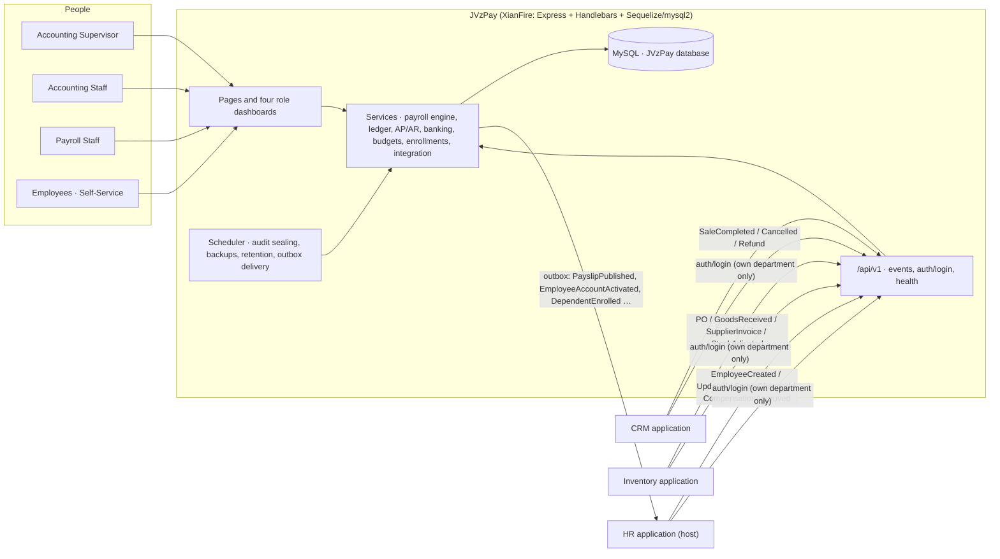
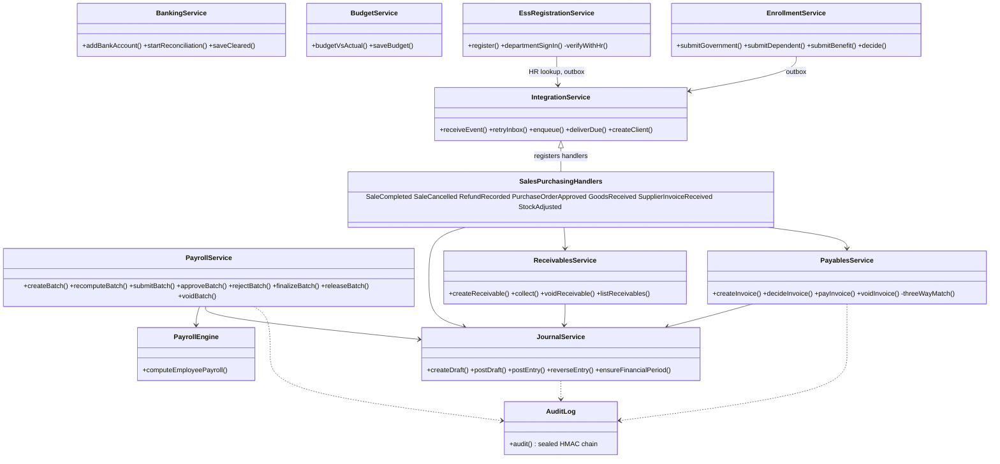

# JVzPay: system design

For the store owner, the panel reviewing the capstone, and the HR, CRM and Inventory developers.
JVzPay is the **Accounting & Payroll** application of the JOHNVIVZ ecosystem (master prompt deliverables 3, 4 and 5).
The diagrams are Mermaid; GitHub, VS Code and most Markdown viewers draw them.

## 1. Architecture

| Layer | In JVzPay |
|---|---|
| Presentation | `views/*.xian` (one page per view), `public/css/app.css` design system, light and dark themes, phone to desktop |
| Routing | `routes/*.js`: URL maps only, every route guarded by a permission |
| Controllers | `controllers/<area>/*Controller.js`: one controller per page |
| Business rules | `services/*.js`: payroll engine, journal (double entry), payables, receivables, banking, budgets, enrollments, registration, integration |
| Data | MySQL with versioned migrations (`database/migrations/001–014`) and one Sequelize model per table (`models/`) |
| Integration | `/api/v1/events` inbox (idempotent), outbox with retries, service tokens, department sign-in API (`docs/API_INTEGRATION.md`) |
| Security | sessions with idle time-out, CSRF, rate limits, lockout, bcrypt, AES-256-GCM for bank and government numbers, sealed audit trail (`docs/SECURITY.md`) |

**Ownership.** HR owns the employee master (JVzPay keeps read-only snapshots with the HR id). Accounting/Payroll owns
payroll, attendance, leave and overtime records (owner's decision), the ledger, payables, receivables and banking.
CRM owns sales and customers; Inventory owns stock and purchasing; JVzPay records only their money effect.

## 2. Entity-relationship diagram (core)

```mermaid
erDiagram
  roles ||--o{ users : has
  roles ||--o{ role_permissions : grants
  permissions ||--o{ role_permissions : in
  departments ||--o{ positions : has
  departments ||--o{ employees : "assigned (from HR)"
  positions ||--o{ employees : "holds (from HR)"
  employees ||--o| users : "signs in as"
  employees ||--o{ employee_verification_records : registers
  employees ||--o{ salary_history : "paid at (effective-dated)"
  employees ||--o{ attendance_records : works
  employees ||--o{ leave_applications : requests
  employees ||--o{ overtime_records : renders
  employees ||--o{ bank_enrollment_requests : submits
  employees ||--o{ statutory_enrollments : submits
  employees ||--o{ dependent_enrollments : declares
  employees ||--o{ benefit_enrollment_references : enrolls
  payroll_periods ||--o{ payroll_batches : groups
  payroll_batches ||--o{ payroll_records : contains
  employees ||--o{ payroll_records : "paid in"
  payroll_records ||--o{ payroll_earnings : itemises
  payroll_records ||--o{ payroll_deductions : itemises
  payroll_records ||--o{ payroll_contributions : itemises
  payroll_records ||--o| payslips : produces
  payroll_batches ||--o{ payroll_approvals : "decided in"
  chart_of_accounts ||--o{ journal_entry_lines : posted
  journal_entries ||--o{ journal_entry_lines : has
  financial_periods ||--o{ journal_entries : "falls in"
  suppliers ||--o{ supplier_invoices : bills
  supplier_invoices ||--o{ supplier_payments : "settled by"
  suppliers ||--o{ purchase_order_references : "ordered from"
  customers ||--o{ accounts_receivable : owes
  accounts_receivable ||--o{ customer_collections : "settled by"
  sales_imports }o--o| accounts_receivable : "on account"
  company_bank_accounts ||--o{ bank_reconciliations : "reconciled in"
  bank_reconciliations ||--o{ bank_reconciliation_items : clears
  journal_entry_lines ||--o| bank_reconciliation_items : "cleared once"
  chart_of_accounts ||--o{ budgets : "budgeted"
  integration_clients ||--o{ integration_inbox : sends
  integration_inbox ||--o{ integration_logs : logs
  integration_outbox ||--o{ integration_logs : logs
```

Every money document links to the journal entry it posted (`journal_entry_id`): supplier invoices and payments,
receivables and collections, CRM sales, payroll batches, income and expense transactions. The full schema, with
constraints and triggers, is in `database/migrations/`.

## 3. Class diagram (services and their collaborators)

## 3a. Timekeeping, vacation leave and the retirement fund (migration 017)

- **Schedules** (`schedule_days`, migration 018): HR plots each employee's day — shift, morning break, lunch, afternoon
  break, end of shift, or a day off — through `ScheduleDaysPlotted`, and can re-plot any day. A day HR has not plotted
  follows the company default (settings `work_start`, `am_break_start`, `lunch_start`, `pm_break_start`, `work_end`,
  `rest_day`, `rest_day_2`). Leave day counts, the encoding sheet, overtime types and payroll use each employee's own
  days off (`scheduleService.daysOffBetween`). A monthly salary's daily rate uses 261 working days a year.
- **Time clock** (`attendance_punches`, `timeClockService`): morning in → [break start → break end] → morning out →
  afternoon in → [break start → break end] → afternoon out. Breaks (15 minutes) are paid, lunch is not. Every minute past
  a plotted break or lunch — the longer of "over the allowance" and "back after the plotted end", e.g. forgetting to punch
  back in — is lost time (`overbreak_minutes`), deducted at the hourly rate on its own payslip line ("Lost hours"). Each punch recomputes the day's
  `attendance_records` row (source `punch`), which Payroll Staff validate as before.
- **My Schedule** is a month calendar; clicking a day shows the plotted shift, breaks, lunch, end of shift, overtime and
  the day's attendance. The page polls `/my/schedule/live` every 30 seconds and reloads when a decision or a re-plot changes the month.
- **Vacation leave**: 10 days a year (`leave_types.annual_entitlement_days`), balances are per year so they reset every
  1 January. `leave_conversions`: from 1 December to 31 January the employee converts what is left; the Accounting
  Supervisor approves; payroll pays it as the non-taxable `LEAVE_CONV` earning and marks it paid at finalization.
- **Retirement fund** (`retirement_enrollments`, `retirement_contributions`, `retirement_withdrawals`): rate × monthly
  basic ÷ paydays in the month is deducted (`RETIREMENT`) and the company adds the same
  (`payroll_records.retirement_company_share`); the accrual journal debits 5060 and credits 2250 with both shares.
  Contributions are recorded at finalization and removed if the payroll is voided. Withdrawal: vested at 25 years
  (`retirement.vesting_years`) → everything; otherwise only the employee's share, the company share is forfeited
  (journal: Dr 2250 / Cr 2260 payable / Cr 4040 forfeited; payout Dr 2260 / Cr 1020).

- **Pay rates** (System Settings → Payroll; Philippine practice): every rate is computed from the fixed monthly BASIC salary
  only — daily = basic × 12 ÷ 261, hourly = daily ÷ 8; allowances, bonuses and overtime are never part of the rate. Basic
  pay and bonuses are taxable. Regular holiday worked 200% (unworked: paid for daily-rated, already in a monthly salary);
  special non-working day worked 130% (no work, no pay); on the employee's day off: approved work 130% for the first
  8 hours and 169% beyond, regular holiday 260%, special day 150%, their overtime 338% / 195%; ordinary-day overtime 125%;
  night differential 10%.

- **Company benefits** (migration 019): two fixed plans from System Settings (benefits.*): the HMO (Cocolife, ₱250,000
  coverage, covering up to 3 verified dependents who are immediate family — spouse, child, parent; `benefit_covered_dependents`)
  and one combined life and accident insurance (fixed provider) with up to 2 beneficiaries who are a spouse or family
  member, sharing equally (`benefit_beneficiaries`). Eligibility: an active employee of an eligible employment type.
- **Bonus tax**: 13th-month pay and other bonuses/incentives are tax-exempt up to ₱90,000 a year (TRAIN law,
  `payroll.bonus_tax_exempt_ceiling`); payroll counts what was already paid that year and taxes only the excess.

- **Who decides employees' requests** (migration 020): Accounting Staff, Payroll Staff and the Accounting Supervisor approve
  or reject leave, overtime, attendance corrections, bank enrollment, dependents and benefits, retirement withdrawals,
  vacation leave conversions and salary loans. Nobody decides their own request or one they filed or encoded.
- **Salary loans** (`salary_loans`, settings `loans.*`): regular employees with 12 months of service; up to 2 months of
  basic salary; 3, 6 or 12 months; 1% a month add-on interest; one loan at a time; the payday deduction (total ÷ paydays,
  rounded up) may not exceed 25% of the payday basic pay. Approved by staff or the supervisor, released by Payroll Staff:
  the release posts Dr 1100 (principal + interest) / Cr 1020 / Cr 4020 and creates an approved LOAN pay item with the
  balance, which payroll deducts every payday; the loan is marked paid when the balance reaches zero (a void reopens it).

- **Pay schedule** (migration 021, `payrollScheduleService`; fixed by the owner): kinsenas 1–15 paid on the 25th;
  katapusan 16–end of month paid on the 10th of the next month. Only the Accounting Supervisor creates periods: a month's
  two fixed periods (the current and next month are created automatically), or special weekly/monthly periods for a
  department or chosen employees whose HR job offer pays that way (`payroll_period_employees`). A payday on a weekend or
  non-working holiday is released the working day before (`release_date`); the 1–15 December period carries the 13th-month
  pay (basic salary earned in the year ÷ 12, PD 851) and is released by 24 December. Each period has one payroll run
  (`payroll_batches`), computed automatically by the hourly scheduler once the cutoff has passed and before the payday,
  recomputed by Payroll Staff from the Payroll tab, then submitted → approved → finalized → released (not earlier than the
  day before the release date). There is no manual batch creation.

- **Two-step approval** (migration 022, `supervisorApproval.js`): leave, vacation leave conversion, overtime and attendance
  corrections are approved first by the employee's immediate supervisor or team leader (from HR, `employees.supervisor_hr_id`):
  in JVzPay under *Team Approvals* when that person has an account; through HR (RequestDecided) when not; by an Accounting
  Supervisor for a Payroll/Accounting employee with no supervisor on record. Only then may Accounting/Payroll Staff or the
  Accounting Supervisor give the final decision, and never the person who gave the first approval. A first-step rejection
  ends the request. Overtime encoded by Payroll Staff needs no first approval.

## 4. Deployment

1. **Requirements:** Node.js 20 or later, MySQL 8, a server reachable by the HR host over HTTPS.
2. **Install:** `npm install`, then `npm run setup` (writes `.env` with generated secrets) and edit `.env`:
   `DB_*`, `SESSION_SECRET`, `DATA_ENCRYPTION_KEY` (keep a copy offline: encrypted bank and government numbers
   cannot be read without it), `COMPANY_NAME`, `COMPANY_ADDRESS`.
3. **Database:** `npm run migrate` (applies `database/migrations` in order), `npm run seed` (roles, permissions,
   chart of accounts, statutory tables, settings and the first Accounting Supervisor).
4. **Integration:** in JVzPay, *System → Integration* → create one token per application and give it to that team.
   Set `HR_API_URL`/`HR_API_TOKEN`, `CRM_API_URL`/`CRM_API_TOKEN`, `INVENTORY_API_URL`/`INVENTORY_API_TOKEN` once those
   applications are online; until then their events wait in the outbox.
5. **Start:** `node index.js` behind a reverse proxy with TLS (or set `HTTPS_CERT_FILE`/`HTTPS_KEY_FILE`). The scheduler
   in the same process seals the audit trail, backs up daily, applies retention and delivers outbox events.
6. **Before the first real payroll:** verify statutory rules and the tax table (*Payroll Setup*), enter the year's
   holidays, and confirm that HR has sent every active employee (payroll refuses records not synchronised from HR).
7. **Tests:** `DB_NAME=JVzPay_test npm run test:e2e` (refuses any database not ending in `_test`) and `npm test`.
   See `docs/TEST_CASES.md`.
8. **Backups and recovery:** `docs/DISASTER_RECOVERY.md`.
